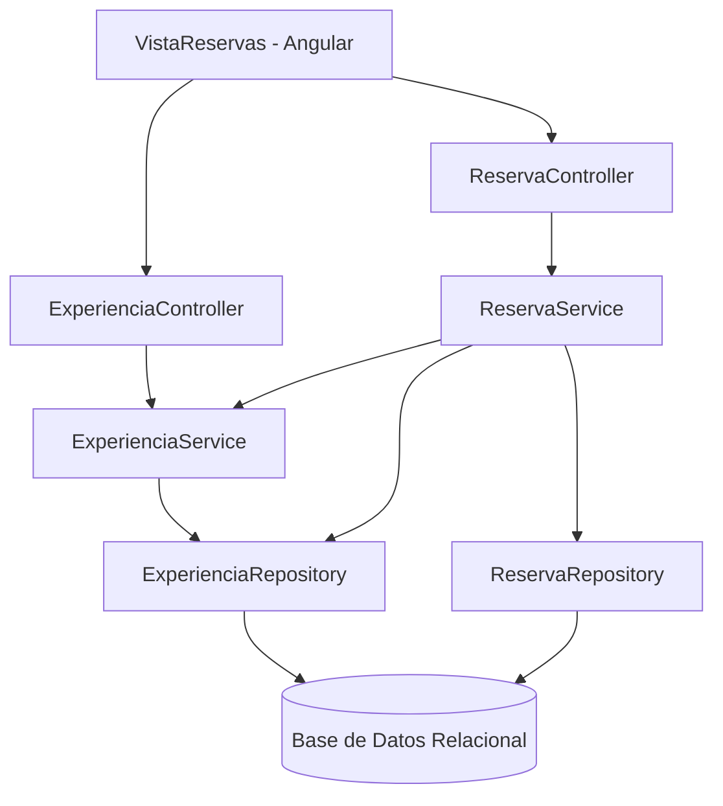
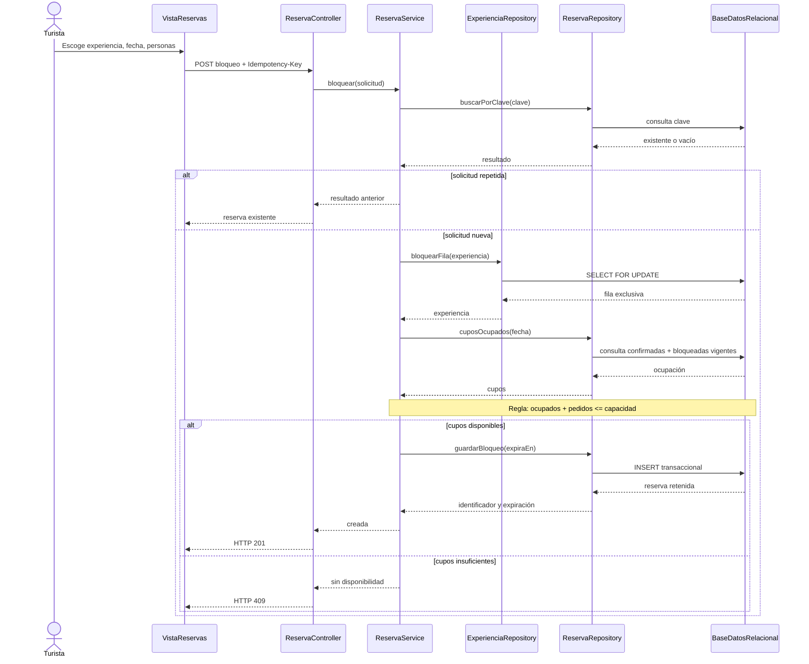

# Arquitectura RutaSur v1

Patrón dominante académico: **MVC** (Vista Angular, Controladores REST Spring y Modelo/lógica de negocio).
Complementos: arquitectura **en capas** y distribución **cliente-servidor**.

`ReservaService` es el dueño de la regla de disponibilidad; la fila `Experiencia` bloqueada mediante
`@Lock(PESSIMISTIC_WRITE)` opera como serialización entre instancias para evitar reservas simultáneas
que superen el aforo. `ReservaRepository` suma exclusivamente confirmadas y retenidas vigentes.

**Limitación consciente:** gran concurrencia entre diferentes fechas de una misma experiencia comparte un mismo bloqueo;
para evolucionar, mover la sincronización a inventario por `experiencia_id + fecha`.

## Secuencia CU-01

El diagrama de secuencia es lógico; los mensajes `INSERT/SELECT FOR UPDATE` son operaciones de persistencia internas a los repositorios.
